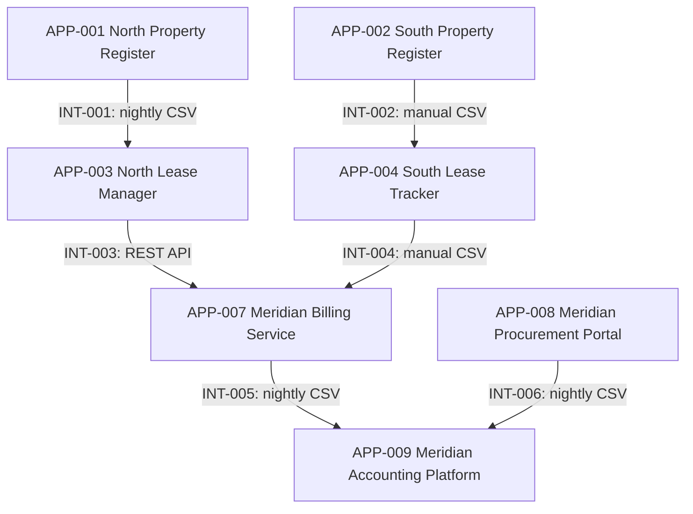

# Current-State Integration Landscape

All applications and connections are synthetic scenario assumptions.
These connections have not yet been implemented.

## Interpretation

Each arrow represents one directional integration from integrations.csv.
It does not establish acknowledgement, reconciliation or recovery.

Seven applications participate in the six registered integrations.

The tenant service desk, maintenance planner and workforce hub are
omitted because the current register contains no integrations for them.
This does not establish that they have no integration needs.

## Assessment questions

- Should North and South use a common lease-to-billing contract?
- What business delays result from manual or nightly transfers?
- How will failed transfers be detected and reconciled?
- How will entity identifiers be preserved through shared services?
- Which additional connections are required by the sampled processes?